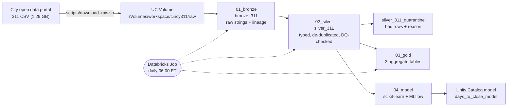

# Cincinnati 311 Service Requests — Databricks Medallion Pipeline + ML

An end-to-end data engineering and machine learning project on Databricks: 2.29 million Cincinnati 311
(non-emergency) service requests flow through a **bronze → silver → gold** Delta Lake pipeline, feed a
**days-to-close prediction model tracked in MLflow** and registered in **Unity Catalog**, and refresh daily
through a **Databricks Job**.

## The problem

Cincinnati residents file 311 requests for things like potholes, trash pickup, tall grass and building
inspections. The city publishes every request, but the raw export is a single 1.29 GB CSV with text dates,
duplicate request IDs and inconsistent values. This project turns it into trusted tables that answer:

- Where and when do residents ask for help?
- How long does each request type take to close, per department?
- What is still open, and how old is it?
- When a request comes in, how many days will it take to close?

## Architecture



| Layer | Table(s) | What happens |
|---|---|---|
| Raw | Unity Catalog Volume `raw` | Source CSV landed as-is |
| Bronze | `bronze_311` | All columns kept as strings, names cleaned to `lowercase_with_underscores`, `_source_file` and `_ingested_at` lineage columns added |
| Silver | `silver_311`, `silver_311_quarantine` | Dates and numbers parsed, text trimmed, neighborhoods standardized, duplicate request numbers removed (latest record kept), `days_to_close` added, failing rows quarantined with a reason |
| Gold | `gold_requests_by_neighborhood_month`, `gold_close_time_by_type`, `gold_open_backlog` | Business-ready aggregates, reconciled against silver |
| ML | `days_to_close_model` (Unity Catalog) | Baseline vs. gradient-boosted models compared on a held-out test set, tracked in MLflow |

All tables live in Unity Catalog under `workspace.cincy311`. Every step is **safe to re-run**: tables are
rebuilt with `overwrite` / `CREATE OR REPLACE`, so re-running never duplicates rows.

## Tools used

- **Databricks** (serverless compute, notebooks, Jobs)
- **Delta Lake** tables and table history
- **Unity Catalog** (catalog/schema, Volume, governed model registry)
- **PySpark** and **Spark SQL**
- **scikit-learn** (`HistGradientBoostingRegressor`, custom median target encoder)
- **MLflow** (experiment tracking, model logging, Unity Catalog registration)
- **Databricks CLI** (deploying notebooks, creating the job from JSON)

## Results

### Data pipeline

| Stage | Rows |
|---|---|
| Raw CSV → bronze | 2,290,305 (70 source columns; matches the city API's row count exactly) |
| Duplicate request numbers removed | 11,544 |
| After de-duplication | 2,278,761 |
| **Passed to silver** | **2,276,284** |
| **Sent to quarantine** | **2,477** |

Quarantine reasons:

| Rows | Reason |
|---|---|
| 1,722 | closed before created |
| 611 | missing department |
| 125 | missing request type; missing department |
| 18 | missing request type |
| 1 | closed date in the future |

Close times are heavily right-skewed: across 2,250,157 silver rows with a close date the **median is 7 days** but the
**average is 85.43 days**, and 122,849 requests took more than a year.

### Gold insights

Close time for the highest-volume request types:

| Request type | Department | Closed requests | Avg days | Median days |
|---|---|---|---|---|
| Metal furniture, special collection | Public Services | 435,540 | 23.67 | 9 |
| Trash, request for collection | Public Services | 104,269 | 5.81 | 2 |
| Pothole, repair | Public Services | 96,795 | 7.72 | 3 |
| Building, residential | Cinc Building Dept | 95,541 | 427.66 | 64 |
| Yard waste | Public Services | 59,387 | 4.28 | 1 |

Open backlog (snapshot 2026-11-11): **26,343 open requests**, and **13,941 of them are more than a year
old**. The largest backlog item is "Building, residential" with 7,639 open requests.

| Age bucket | Open requests |
|---|---|
| 0–7 days | 970 |
| 8–30 days | 2,125 |
| 31–90 days | 3,653 |
| 91–365 days | 5,654 |
| Over 1 year | 13,941 |

Reconciliation checks confirm gold totals equal silver totals (2,276,284 requests; 2,249,940 closed;
26,343 open). These checks caught 217 requests marked OPEN that also had a close date (likely reopened);
the close-time table now uses only requests the city marks CLOSED so nothing is double-counted.

### Model: predicting days_to_close

Features: request type, department, neighborhood, month, day of week. Data: a fixed-seed sample of
1,011,530 closed requests, split 809,224 train / 202,306 test.

| Model | Test MAE (days) | Median abs. error (days) |
|---|---|---|
| Baseline: median per request type | 70.78 | 5.00 |
| HistGradientBoostingRegressor | 71.46 | 4.86 |
| **HistGradientBoosting + type-median target encoding** | **70.01** | **4.72** |

- The plain gradient-boosted model did **not** beat the baseline: 1,263 request types exceed the
  255-category limit of the trees, so rare types were grouped and information was lost.
- Adding a smoothed, leakage-safe median target encoding of request type made it the best model
  (1.1% lower MAE than the baseline). It is registered as `workspace.cincy311.days_to_close_model` version 2.
- The gain is small because most of the error comes from the long tail of multi-year cases, which these
  five features cannot explain. Better signals (priority, inspection required, current department backlog)
  would be the next step.

### Orchestration

The Databricks Job `cincy311_daily_pipeline` runs `01_bronze → 02_silver → 03_gold` as dependent serverless
tasks every day at 06:00 America/New_York. A full test run took 166 seconds (bronze 65 s, silver 67 s,
gold 22 s) and produced identical row counts to the previous run, confirming the pipeline is idempotent.

### AI categorization step (skipped)

The plan included an LLM step to categorize free-text request descriptions. Profiling showed the public
export contains no resident-written text: every text column is a coded label (longest value 45 characters).
Comparing an LLM category with the request type would only compare the label with itself, so the step was
skipped rather than report a meaningless agreement rate.

## How to run it

**Prerequisites:** a Databricks workspace with Unity Catalog and serverless compute, and the
[Databricks CLI](https://docs.databricks.com/dev-tools/cli/) logged in (`databricks auth login --host <workspace-url>`).

1. **Create the schema and Volume**
   ```bash
   databricks schemas create cincy311 workspace
   databricks volumes create workspace cincy311 raw MANAGED
   ```
2. **Land the raw data** (downloads the CSV locally and uploads it, because serverless compute in the
   workspace used here has no outbound internet)
   ```bash
   ./scripts/download_raw.sh
   ```
3. **Upload the notebooks**
   ```bash
   databricks workspace import-dir notebooks /Users/<your-user>/cincy311 --overwrite
   ```
4. **Run the pipeline and model** — open the notebooks in Databricks and run them in order:
   `01_bronze`, `02_silver`, `03_gold`, `04_model`.
5. **Schedule it** — creates (or updates) the daily job from `jobs/cincy311_daily_pipeline.json`:
   ```bash
   ./scripts/create_job.sh
   ```

All scripts accept a CLI profile name as the first argument (default `DEFAULT`).

## Repository layout

```
notebooks/
  01_bronze.py      raw CSV -> bronze Delta table
  02_silver.py      typing, cleaning, de-dup, data quality + quarantine
  03_gold.py        three gold aggregate tables + reconciliation checks
  04_model.py       baseline vs scikit-learn models, MLflow tracking, UC registration
scripts/
  download_raw.sh   land the source CSV in the UC Volume
  create_job.sh     create/update the daily Databricks Job
jobs/
  cincy311_daily_pipeline.json   job definition (bronze -> silver -> gold, daily)
```

## Limitations and next steps

- The daily job reprocesses the CSV already in the Volume; new city data arrives only when
  `download_raw.sh` runs. With outbound network access (or Auto Loader on a landing folder) this becomes
  fully automatic and incremental.
- Bronze and silver are full rebuilds. At larger scale, an incremental `MERGE` on `sr_number` would be cheaper.
- The model is trained on a sample with a random split; a time-based split would better reflect
  predicting future requests.

## Data source and license

Data: [Cincinnati 311 (Non-Emergency) Service Requests](https://data.cincinnati-oh.gov/) (Socrata dataset
`gcej-gmiw`), City of Cincinnati open data portal. Built on a Databricks trial workspace for learning and
non-commercial portfolio use.
